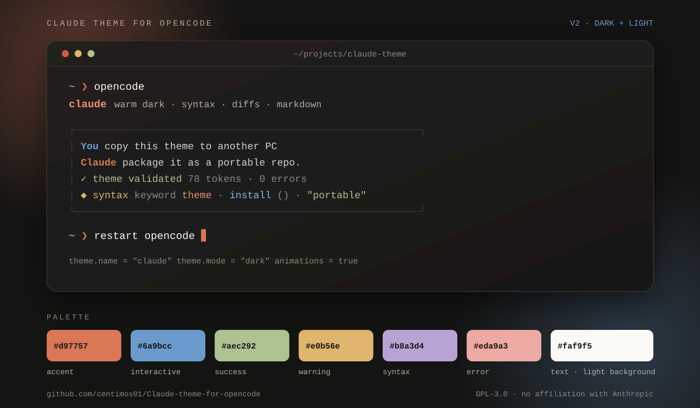

# Claude theme for OpenCode

Tema cálido inspirado en la estética de Claude Code para **OpenCode V2**. Incluye variantes **dark** y **light**, paleta basada en los colores de Anthropic, resaltado de sintaxis, markdown, diffs y estados interactivos legibles.

Documentación oficial del formato: [OpenCode V2 · Themes](https://opencode.ai/v2/docs/cli/theme/).

[](https://github.com/centimos01/Claude-theme-for-opencode/actions/workflows/validate.yml)
[](LICENSE)



## Paleta

| Rol | Dark | Light |
| --- | --- | --- |
| Fondo | `#141413` | `#faf9f5` |
| Superficie | `#22201e` | `#e8e6dc` |
| Texto | `#faf9f5` | `#141413` |
| Texto secundario | `#d6d3ca` | `#3a3935` |
| Acento (terracota) | `#d97757` | `#8f3f24` |
| Interacción (azul) | `#6a9bcc` | `#355878` |
| Éxito (salvia) | `#aec292` | `#4a5c36` |
| Aviso (ámbar) | `#e0b56e` | `#744806` |
| Error | `#eda9a3` | `#7a2f29` |

## Requisitos

- OpenCode V2 (`opencode --version`).
- **Windows:** PowerShell 5.1 o superior.
- **macOS / Linux:** bash y, para activar automáticamente, `python3`.
- **Opcional:** Node.js 20+ solo para ejecutar el validador.

## Instalación rápida

### Windows

```powershell
git clone https://github.com/centimos01/Claude-theme-for-opencode.git
cd "Claude-theme-for-opencode"
.\install.ps1
```

Si PowerShell bloquea el script:

```powershell
powershell -ExecutionPolicy Bypass -File .\install.ps1
```

### macOS / Linux

```bash
git clone https://github.com/centimos01/Claude-theme-for-opencode.git
cd Claude-theme-for-opencode
chmod +x install.sh
./install.sh
```

El instalador:

1. Copia `themes/claude.json` a `~/.config/opencode/themes/`.
2. Hace backup si ya existía.
3. Activa el tema en `cli.json` sin borrar el resto de preferencias.
4. Respeta `XDG_CONFIG_HOME` si está definido.

Después, **reinicia OpenCode**.

## Activación manual

Copia el tema:

```bash
mkdir -p ~/.config/opencode/themes
cp themes/claude.json ~/.config/opencode/themes/
```

En Windows:

```powershell
New-Item -ItemType Directory -Force "$env:USERPROFILE\.config\opencode\themes" | Out-Null
Copy-Item .\themes\claude.json "$env:USERPROFILE\.config\opencode\themes\"
```

Añade el bloque `theme` a `~/.config/opencode/cli.json` (si ya existe, no borres tus otras claves):

```json
{
  "$schema": "https://opencode.ai/v2/cli.json",
  "theme": {
    "name": "claude",
    "mode": "dark"
  },
  "animations": true
}
```

También puedes ejecutar `/themes` dentro de OpenCode y seleccionar `claude`.

## Modo claro

Los instaladores aceptan el modo como parámetro:

```powershell
.\install.ps1 -Mode light
```

```bash
./install.sh --mode light
```

Valores válidos: `dark`, `light` y `system`.

## Opciones de instalación

| Windows | macOS / Linux | Efecto |
| --- | --- | --- |
| `-NoActivate` | `--no-activate` | Copia el tema sin tocar `cli.json`. |
| `-Mode light` | `--mode light` | Activa la variante clara. |
| `-Mode system` | `--mode system` | Sigue el modo del terminal. |

## Validación

```bash
node scripts/validate-theme.mjs themes/claude.json
node scripts/validate-theme.mjs themes/claude.json --verbose
```

El validador comprueba:

- Los 78 tokens base que exige este validador (conjunto propio, más estricto que el esquema V2).
- Las 11 rampas de color y sus 9 pasos en cada modo.
- Referencias `$hue.*`, `$text.*` y `$background.*` sin ciclos.
- Pares texto/fondo de todos los estados de acción, incluidos los fondos transparentes.
- Formularios, feedback y tokens de texto sobre las superficies base, elevadas y de diálogo.
- Diffs, resaltados y números de línea.
- Contraste WCAG: 4.5:1 para texto, 3:1 para UI y elementos deshabilitados.\n- Colores hex opacos (3 o 6 dígitos); los colores con alpha se rechazan.

## Estructura

```text
.
├─ themes/
│  └─ claude.json
├─ examples/
│  └─ cli.json
├─ scripts/
│  └─ validate-theme.mjs
├─ assets/
│  └─ preview.svg
├─ install.ps1
├─ install.sh
├─ .github/workflows/validate.yml
├─ .gitattributes
├─ .gitignore
├─ LICENSE
└─ README.md
```

## Solución de problemas

- **`cli.json` con comentarios:** el instalador se detiene sin modificarlo. Añade el bloque `theme` manualmente o elimina los comentarios.
- **`python3` no disponible en macOS/Linux:** el tema se instala igualmente; el instalador muestra cómo activarlo manualmente. También puedes usar `--no-activate`.
- **macOS pide instalar Command Line Tools al ejecutar `python3`:** usa `./install.sh --no-activate` o instala las CLT y vuelve a ejecutar el instalador.
- **El tema no aparece:** reinicia OpenCode por completo y revisa que `theme.name` sea `claude` en `cli.json`.

## Desinstalar

1. Borra `~/.config/opencode/themes/claude.json`.
2. Cambia el tema en `cli.json` o elimina el bloque `theme`.
3. Reinicia OpenCode.

Los backups creados por el instalador tienen el sufijo `.bak-*` y un identificador único.

## Aviso

Proyecto no afiliado a Anthropic. **Claude** es una marca de Anthropic, PBC. La paleta está inspirada en la identidad visual de Claude y Anthropic; este repositorio no incluye código de Anthropic.

## Licencia

[GPL-3.0](LICENSE).

Copyright (C) 2026 Centimos01.
